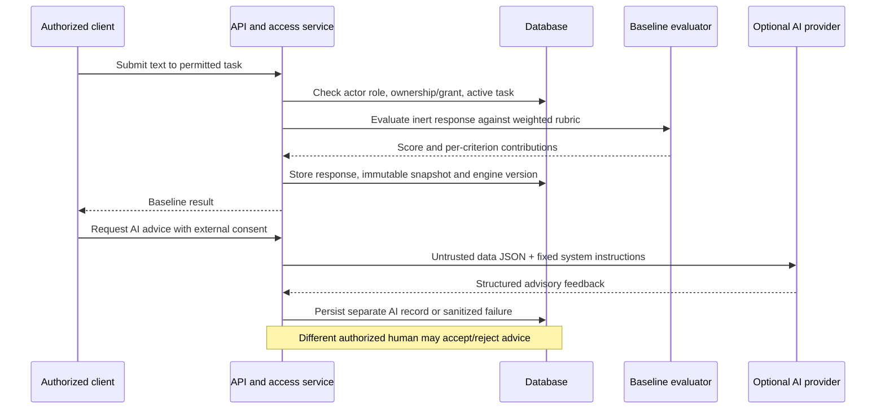

# Architecture and decisions

APIForge extends the original modular monolith. There are no execution workers or microservices because the application never runs submitted code. Synchronous database/provider operations run in FastAPI's worker thread pool.

| Module | Responsibility |
|---|---|
| `app/main.py` | App assembly, HTTP errors, request IDs, JSON completion logs, CORS, health routes |
| `app/config.py` | Environment settings; production/key/provider validation |
| `app/middleware.py` | Pre-parser body cap and bounded request-body receive time, including chunked input |
| `app/security.py` | Argon2id, PyJWT validation, current-user/admin dependencies, auth throttling |
| `app/api/auth.py` | Registration, login, current identity, admin-only bounded user listing and role changes |
| `app/api/routes.py` | Task/history/access/comparison HTTP contracts |
| `app/services/tasks.py` | Resource visibility, write authorization, atomic revision checks, snapshots, archival |
| `app/services/evaluator.py` | Inert, bounded exact/contains/regex scoring with category contributions |
| `app/services/ai.py` | Provider protocol, HTTP adapter, structured feedback, persisted failures, independent review |
| `app/api/ai.py` | Optional AI requests, comparison with baseline, human-review endpoints |
| `app/models.py`, `app/database.py` | SQLAlchemy models, session lifecycle, SQLite foreign keys |
| `app/bootstrap.py` | Operator-only first-admin creation, protected by singleton DB guard |
| `migrations/` | Incremental schema history; original migration remains unchanged |

## Identity and authorization

JWTs contain subject, expiration, issued-at, issuer, audience, unique token ID, and token-version number. The database supplies current role/activation state on every request; role changes increment token version and invalidate older tokens. HS256 is an explicit allowlist, not inferred from caller input.

Admins can inspect/manage all tasks and users. Evaluators can create tasks and edit/evaluate owned tasks or editor-granted tasks. Viewers cannot write even if mistakenly given an editor grant. Reader grants allow viewing the task and its history, including submissions and AI advice; grant access only when that sharing is intended. Editors cannot grant further access unless they own the task. Legacy ownerless tasks are admin-only. All evaluation and comparison paths re-check the parent task's visibility.

## Transactions and concurrency

One request-scoped session closes after each request. Services commit their write unit; failure teardown rolls back uncommitted work. Updates and archival use conditional SQL `WHERE revision = expected_revision AND archived_at IS NULL`; one competing writer wins and another receives 409. Revisions are never caller-assigned. Submission snapshots reflect the task revision read by that submission; an in-flight authorized submission may complete while another transaction updates or archives its task.

AI calls are synchronous and bounded; they do not hold an explicit database row lock. A provider failure creates a separate `failed` AI record with a safe error code, so deterministic history remains usable. Process crashes mid-call are not durably tracked; a queue and idempotency are future work. Human review uses a conditional state transition from `pending_review` to avoid conflicting decisions. Feedback/score fields are not editable through the API.

## Scoring

For category c, compute `category_score = passed_criterion_weight / category_total_weight`. Then compute `100 * sum(category_score * category_weight) / sum(category_weight)`. Round the final score to two decimal places; per-rule contributions are rounded to four decimals for explanation. Their displayed sum can have tiny rounding differences. Empty/unused/duplicate categories are rejected. Legacy tasks default to a single general category, preserving the original weighted-rule calculation.

Regex is literal configured policy, not submitted code. Patterns are limited to 512 characters, 20 groups and numeric bounds <=1000; response text <=50,000 characters; each match has a 10 ms timeout. A timeout scores only that rule zero and sets `completed_with_limits`. Ordinary results are reproducible; resource-limit outcomes can vary with hardware/load and should be reviewed. Stronger restricted linear-time regex syntax is a future improvement.
