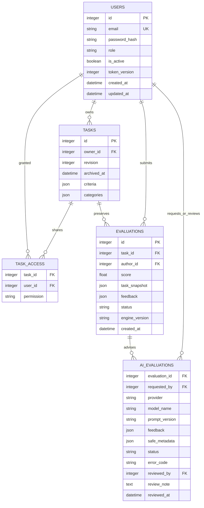

# Database schema and safe upgrades

Tasks also retain title, description, language, difficulty, expected outcome and creation/update times. Evaluations retain the inert response. AI records have their own ID and creation timestamp. A singleton `bootstrap_state` guard (ID=1) prevents races or repeated operator bootstrap. It has no public endpoint.

Database constraints include unique normalized user email; role/access/status allowlists; score range 0–100; positive task revision; difficulty allowlist; unique task/user grant. Indexes cover ownership, language/difficulty, task grants, evaluation task ID and AI baseline ID. API validation additionally enforces rubric bounds and categories. JSON columns are portable SQLAlchemy JSON, not PostgreSQL-specific JSONB. Direct DB writers must respect application-level constraints.

Task deletion now means setting `archived_at` and advancing the revision. FK references from evaluations use RESTRICT; no API physically deletes tasks or results. Archive filtering is applied before pagination. Historical snapshots, original scores, author attribution, timestamps and engine version remain unchanged. Reader grants authorize all task history, including stored response text and AI advice. Revoke access when sharing should end.

UTC timestamps are generated by the application. SQLite may serialize them without an offset; interpret those values as UTC. PostgreSQL preserves timezone information. Displayed scores use floating-point arithmetic and final two-decimal rounding.

## Migration chain

| Revision | Change |
|---|---|
| 0001 | Original tasks/evaluations; retained unchanged |
| 0002 | Users, singleton bootstrap guard, ownership, grants, archive field, statuses, constraints, RESTRICT evaluation FK |
| 0003 | Category-aware rubrics; existing tasks receive one general category |
| 0004 | Separate optional AI advice and human-review records |
| 0005 | Widen evaluation status for completed_with_limits on PostgreSQL |

No users are silently created during migration. Existing tasks have null owners and are admin-only; existing evaluation authors remain null. Existing IDs, revisions, responses, snapshots, engine versions and scores are preserved. Baseline rows are never recomputed. The legacy upgrade tests seed 0001 rows, upgrade to head, and verify preservation and schema drift on both supported databases.

Back up first. Stop writers, apply `alembic upgrade head` exactly once, run `alembic check`, check readiness, then restore traffic. SQLite batch migrations temporarily disable foreign keys on the migration connection to avoid triggering the original cascade while recreating tables; `foreign_key_check` runs after migration. Normal application connections keep FK enforcement enabled. Migrations must run online; SQLite recreation and existing-constraint discovery require a real database.

Security revision 0002 is intentionally forward-only: silently rolling back authentication/ownership can expose data. Use a reviewed backup/restore procedure for rollback. Status widening 0005 is also forward-only to avoid truncating recorded statuses. Other later revisions have narrow downgrade operations, but dropping AI/category data is destructive. Do not run downgrade commands on valuable data. Rehearse restore, not just schema upgrade. Schema changes are not a substitute for backups.
