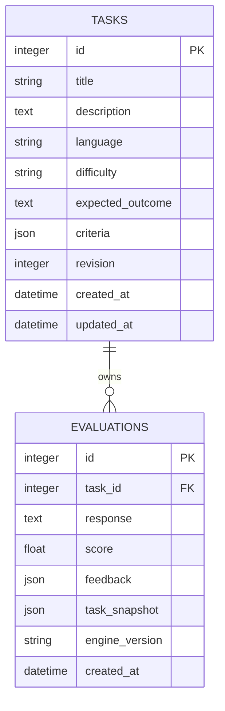

# Database schema



All columns are non-null. Integer primary keys are database-generated. Task language and difficulty and evaluation task ID have indexes. Criteria, feedback, and snapshots use portable SQLAlchemy JSON rather than PostgreSQL-specific JSONB. Text length and enum limits are enforced by the API, not SQLite column width. Direct database writers must preserve those invariants.

An evaluation stores the response, a 0–100 score rounded to two decimal places, criterion results, engine version, and a complete task-input snapshot plus revision. Evaluations are immutable through the API. Snapshots support understanding historical scores after edits, but task deletion removes its evaluations through `ON DELETE CASCADE`. SQLite connections explicitly enable foreign keys. Retention-sensitive deployments should replace deletion with archival or soft deletion.

Dates are generated in UTC by the application. PostgreSQL preserves timezone information; SQLite stores timezone-naive values representing UTC, so clients must interpret those timestamps as UTC. Scores are floating point presentation values, not financial calculations.

## Migrations

```bash
alembic upgrade head
alembic current
alembic check
# Destructive: removes application data; use only on a disposable database.
alembic downgrade base
```

The initial revision explicitly creates tables and indexes; it does not import live models into migration operations. `alembic check` detects model/schema drift. To extend the schema, modify models, run `alembic revision --autogenerate -m 'description'`, review the generated migration, and test upgrade/downgrade on disposable SQLite and PostgreSQL databases. Never edit an already-deployed revision.

SQLite is convenient for a local single-process demo. PostgreSQL is preferable for concurrent writers and production operations. Configuration supports SQLAlchemy's `postgresql+psycopg` URL; no queries rely on SQLite-specific functions. SQLite unit/API tests and PostgreSQL CI integration provide complementary checks, not a guarantee of identical concurrency behavior.
